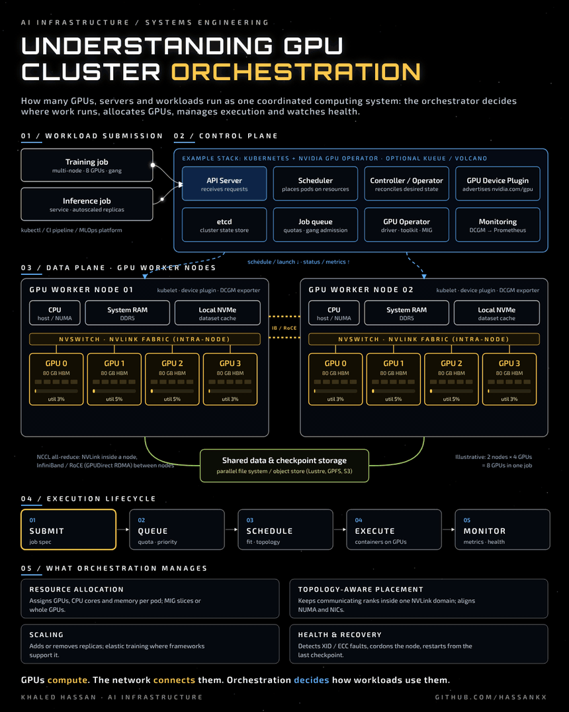

[🌌 View the black-and-Milky-Way themed page](index.html) · [Open HTML source](https://github.com/hassankx/gpu-cluster-orchestration/blob/main/index.html)

> GitHub README pages use GitHub's own theme. Download `index.html` and open it in a browser to see the full starfield design.

# Understanding GPU Cluster Orchestration

<p align="center"></p>

> **GPUs compute. The network connects them. Orchestration decides how workloads use them.**

At the infrastructure layer, GPU cluster orchestration handles many operations at once. It coordinates compute resources across multiple physical machines: deciding where each workload runs, managing GPU execution and monitoring system health, rather than treating every GPU as an isolated unit.

## 1. Workload submission

Training and inference jobs enter through one front door, from `kubectl`, a CI pipeline or an MLOps platform.

| Workload | Typical shape |
| --- | --- |
| Training | Multi-node, many GPUs, all ranks must start together (gang scheduling) |
| Inference | Long-running service, replicas scaled with demand |

## 2. Control plane

Example stack: **Kubernetes + NVIDIA GPU Operator + GPU device plugin**, optionally with a batch queue such as Kueue or Volcano.

| Component | Role |
| --- | --- |
| API server | Receives and validates requests |
| Scheduler | Places pods on nodes that have the requested resources |
| Controller / Operator | Continuously reconciles the actual state toward the desired state |
| GPU device plugin | Discovers GPUs on each node and advertises them (for example `nvidia.com/gpu`) |
| GPU Operator | Installs and manages the driver, container toolkit, device plugin, MIG configuration and DCGM monitoring |
| Job queue | Applies quotas and priorities, and admits multi-GPU jobs as a gang |
| Monitoring | DCGM exporter metrics into Prometheus and alerting |

## 3. Data plane: GPU worker nodes

Each worker node combines CPUs, system RAM, local NVMe storage and several GPUs.

- **Inside a node:** GPUs talk over **NVLink / NVSwitch**, far faster than PCIe.
- **Between nodes:** jobs scale out over **InfiniBand or RoCE**, usually with GPUDirect RDMA, while NCCL runs the collective operations (all-reduce, all-gather).
- **Storage:** a shared data and checkpoint tier (parallel file system or object store) feeds datasets and holds checkpoints, so a job can resume after a failure.

## 4. Execution lifecycle

```
Submit  →  Queue  →  Schedule  →  Execute  →  Monitor
```

1. **Submit:** the job spec declares images, GPUs, CPU and memory.
2. **Queue:** quotas, priorities and gang admission decide when it may start.
3. **Schedule:** the scheduler finds nodes that fit, ideally topology-aware.
4. **Execute:** containers start on the assigned GPUs; ranks communicate over NVLink and the fabric.
5. **Monitor:** utilisation, memory, temperature and error counters are collected; failures trigger recovery.

## 5. What orchestration manages

| Responsibility | What it means in practice |
| --- | --- |
| **Resource allocation** | Assigns CPU, memory and GPU devices (whole GPUs or MIG slices) to each workload |
| **Topology-aware placement** | Aligns placement with the physical layout, for example keeping ranks that communicate most within the same NVLink domain and close to their NICs |
| **Scaling** | Adjusts replicas, and supports elastic training where the framework allows it |
| **Fault tolerance and recovery** | Detects hardware errors (such as XID or ECC events), cordons the node, and restarts or fails over the workload from its last checkpoint |

## Files

- [`assets/gpu-orchestration.gif`](assets/gpu-orchestration.gif): animated diagram
- [`assets/gpu-orchestration.mp4`](assets/gpu-orchestration.mp4): video version
- [`assets/gpu-orchestration.png`](assets/gpu-orchestration.png): still image

The diagram is illustrative: two worker nodes with four GPUs each, eight GPUs in one job. Component names are examples; other schedulers such as Slurm follow the same pattern.

---

Khaled Hassan · Lead, Research Computing & AI Infrastructure · [github.com/hassankx](https://github.com/hassankx)
